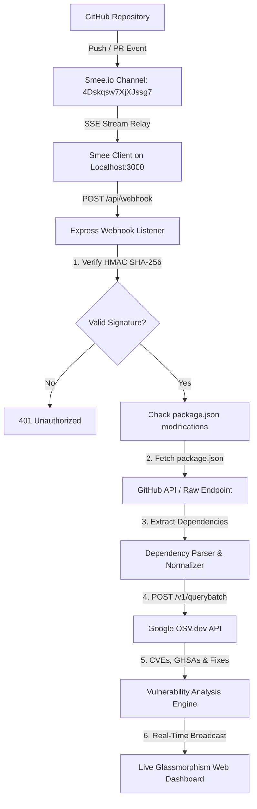

# VulnWatch 🛡️ — GitHub Webhook OSV Vulnerability Scanner

> Automated open-source dependency vulnerability scanner integrating **GitHub Webhooks**, **Google/OpenSSF OSV.dev API**, **Smee.io Relay**, and a **Live Dark-Mode Security Dashboard**.

---

## 🌟 Key Features

1. **GitHub Webhook Integration**: Listens for `push` and `pull_request` events automatically whenever code is pushed.
2. **Smee.io Local Webhook Tunneling**: Uses [smee.io](https://smee.io) to deliver webhooks directly to your local development machine without needing ngrok, public IP, or port forwarding.
3. **HMAC SHA-256 Webhook Verification**: Cryptographically validates GitHub's `X-Hub-Signature-256` header against your secret key (`GITHUB_WEBHOOK_SECRET`).
4. **Google / OpenSSF OSV.dev Batch API**:
   - Free, fast, open-source vulnerability database.
   - Audits npm packages against known CVEs and GHSAs.
   - Categorizes severity (**Critical**, **High**, **Medium**, **Low**).
   - Provides recommended patch/upgrade versions (`npm i package@version`).
5. **Support for Public & Private Repositories**:
   - **Public Repos**: Fetches `package.json` instantly without authentication.
   - **Private Repos**: Seamlessly uses GitHub App authentication or `GITHUB_TOKEN` (Personal Access Token).
6. **Real-Time Web-Based UI Dashboard**:
   - **Live Metrics**: Total scanned dependencies, clean count, vulnerable count, and severity distribution.
   - **Vulnerability Explorer**: Search by CVE, GHSA, or package name; filter by severity; 1-click copy fix commands.
   - **Software Bill of Materials (SBOM)**: Complete table of all scanned production & development packages.
   - **On-Demand Manual Scanner**: Test any GitHub repo or paste raw `package.json` JSON on the fly!
   - **Live Webhook & Activity Terminal**: Real-time event log powered by Server-Sent Events (SSE).

---

## 📐 Architecture Workflow



---

## ⚙️ Configuration (`.env`)

Your `.env` file is pre-configured with your credentials:

```ini
PORT=3000

# Smee.io Webhook Delivery Channel
SMEE_URL=https://smee.io/4Dskqsw7XjXJssg7

# GitHub Webhook Secret
GITHUB_WEBHOOK_SECRET=dghdfhsdfjsfgjsfgjf

# GitHub App Credentials
GITHUB_APP_ID=5376729
GITHUB_APP_PRIVATE_KEY=./github-key.pem
GITHUB_CLIENT_ID=Ov23li5fMOlqDKL4tOMr
GITHUB_CLIENT_SECRET=55e11291a0495c4db4ab402c56de081243a7671b

# Optional: Personal Access Token (for private repos)
GITHUB_TOKEN=
```

---

## 🚀 How to Run

### 1. Install Dependencies
```bash
npm install
```

### 2. Start the Server
```bash
npm start
```
Or for auto-reload during development:
```bash
npm run dev
```

### 3. Open the Dashboard
Visit `http://localhost:3000` in your web browser.

---

## 🔗 GitHub Webhook Setup Guide

1. Open your GitHub Repository in your browser.
2. Go to **Settings** &rarr; **Webhooks** &rarr; Click **Add webhook**.
3. Fill in the following:
   - **Payload URL**: `https://smee.io/4Dskqsw7XjXJssg7`
   - **Content type**: `application/json`
   - **Secret**: `dghdfhsdfjsfgjsfgjf`
   - **SSL verification**: Enable SSL verification
   - **Which events would you like to trigger this webhook?**:
     - Select *"Just the push event"* OR *"Let me select individual events"* (Pushes, Pull requests).
4. Click **Add webhook**.
5. GitHub will send an initial `ping` event. You will immediately see the ping in your VulnWatch Dashboard under the **Webhook Logs** tab!

---

## 🔒 Private Repository Support

- **For Public Repositories**: No authentication is required. The scanner reads `package.json` directly.
- **For Private Repositories**:
  - **Option 1 (Easiest)**: Generate a GitHub Personal Access Token (`read:packages`, `repo` scope) and set it in `.env` as `GITHUB_TOKEN=ghp_your_token`.
  - **Option 2 (GitHub App)**: Install your GitHub App (`App ID: 5376729`) on the target repository and place your `github-key.pem` in the root folder.

---

## 🧪 Testing Without a Commit

You don't need to push code to GitHub to test the vulnerability scanner:
1. Open the Dashboard at `http://localhost:3000`.
2. Go to the **On-Demand Scanner** tab.
3. Click **"Load Sample package.json"** (loads packages with known CVEs: `lodash 4.17.15`, `axios 0.21.1`, etc.).
4. Click **"Analyze Dependencies"** to see live vulnerability cards and remediation commands!
